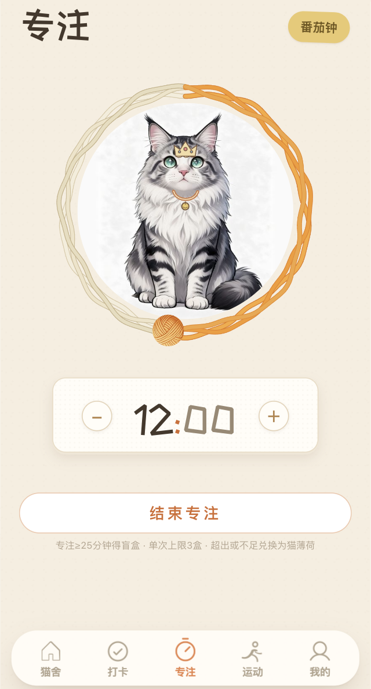
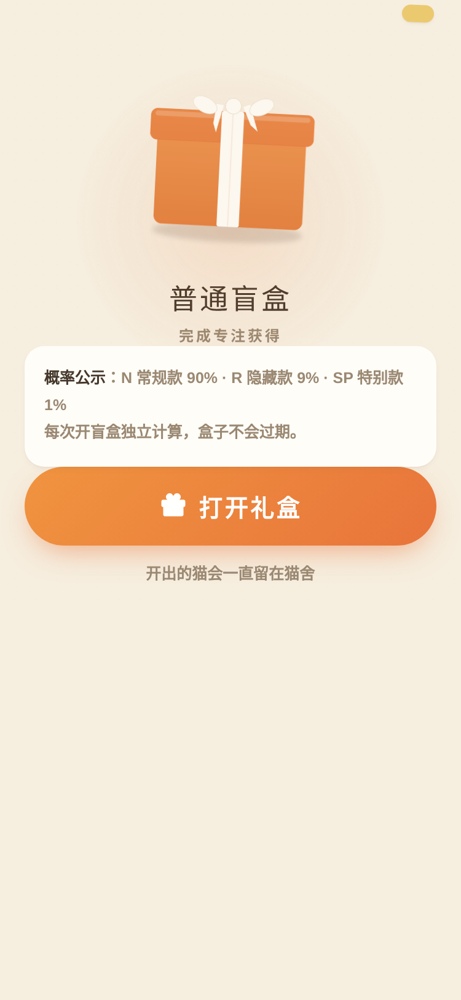
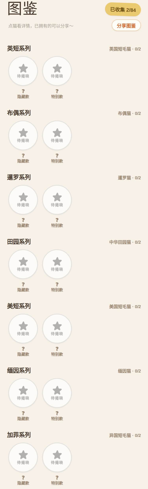
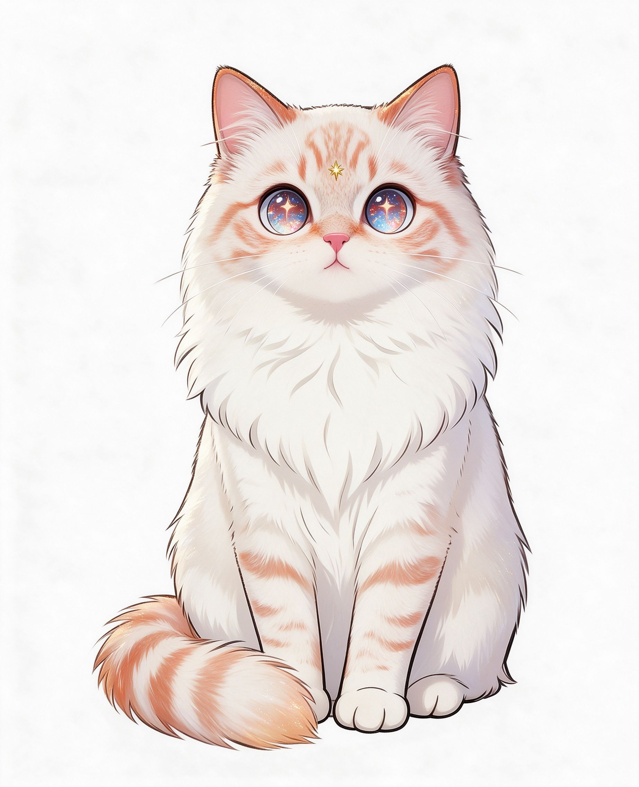
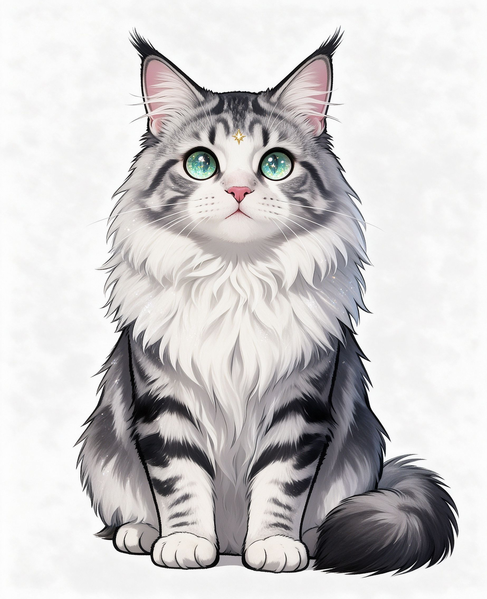
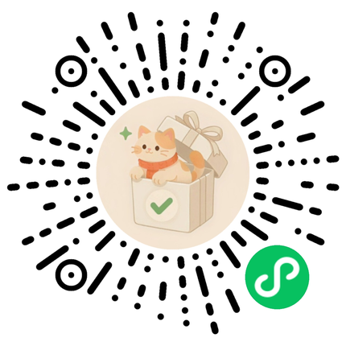

# 喵呜专注 · RoutineCat

> 一个把「专注 25 分钟」变成开猫盲盒的微信小程序。
> 专注满 25 分钟或走够 8000 步，掉一个盲盒——84 只猫、7 个系列，慢慢集。

---

## 它是什么

「喵呜专注」是一款治愈系专注工具：不打卡内卷，不排行榜施压，用一只猫陪你把时间花掉。

- **专注 25 分钟** → 掉一个盲盒
- **走够 8000 步** → 掉一个盲盒
- **打卡** → 攒猫薄荷，连续打卡才送盒
- **84 只猫 / 7 个系列** → N 普通 / R 隐藏 / SP 特别三档
- **拍立得猫舍** → 开出来的猫常驻首页，摸头 +1 亲密度
- **饰品装扮** → 5 个部位、10 款饰品，拖、转、缩放自由摆放

断签会清零，但每周送一张免断护盾。猫不会因为你就没来，而生气。

---

## 截图预览

### 小程序页面

| 专注 | 开盒 | 图鉴 |
|---|---|---|
|  |  |  |

### 猫猫图鉴（节选）

| 流霞（布偶·隐藏） | 夜瞳（加菲·隐藏） | 雪冕（缅因·隐藏） |
|---|---|---|
|  |  |  |

更多猫咪见 [猫猫图鉴](docs/cat-gallery.md)。

### 管理后台

后台用于管理用户、盲盒商品、猫系列、猫咪档案与操作日志。

详见 [后台功能模块](docs/admin.md)。

---

## 体验方式

微信扫一扫，或搜索「喵呜专注」。

---

## 文档

- [功能模块介绍](docs/features.md) — 小程序各模块玩法说明
- [猫猫图鉴](docs/cat-gallery.md) — 七个系列、稀有度与部分猫咪展示
- [后台功能模块](docs/admin.md) — 管理端能力与截图

---

## 说明

本仓库是产品介绍页，仅包含文档与截图。小程序代码、云函数、后台源码均未公开。如需体验请扫描上方小程序码。
