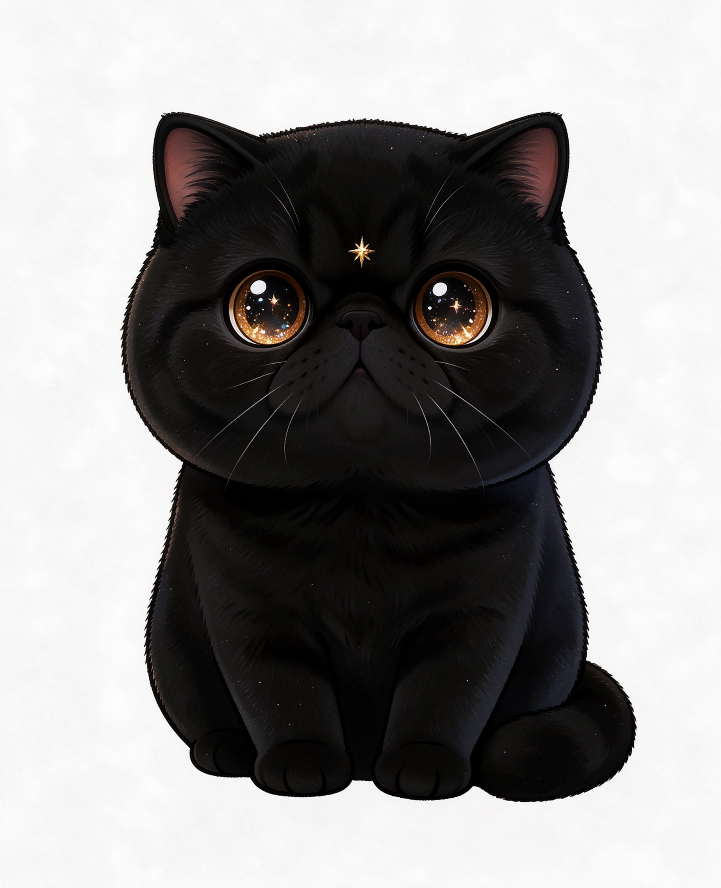
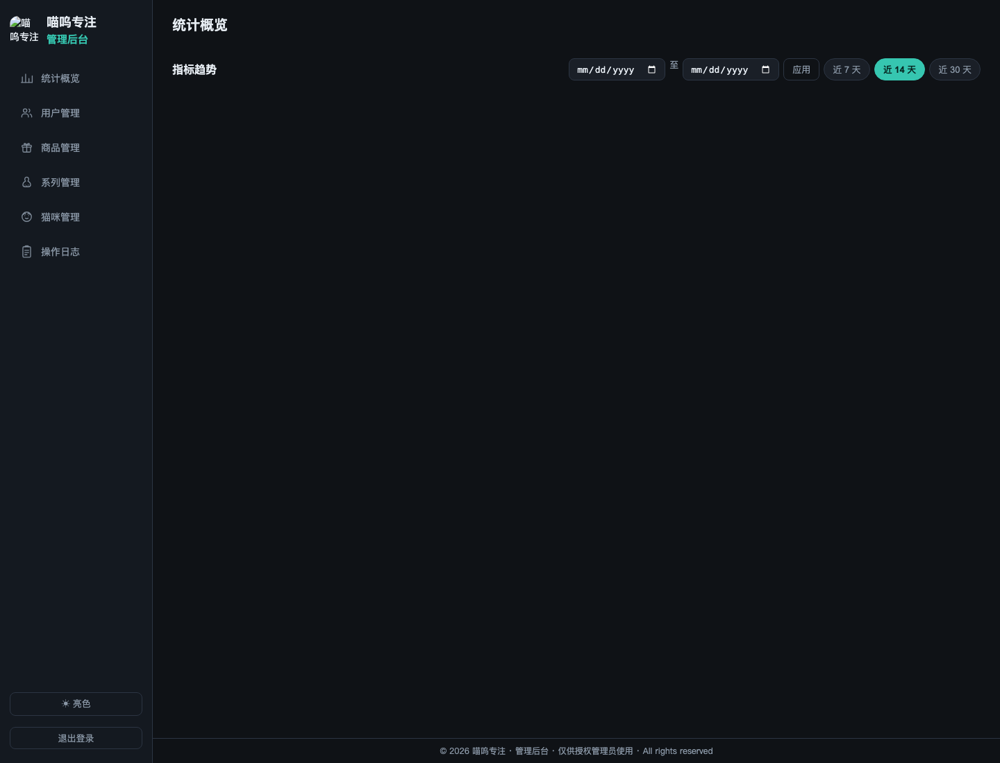

# 喵呜专注 · RoutineCat

> 一个把「专注 25 分钟」变成开猫盲盒的微信小程序。
> 专注满 25 分钟或走够 8000 步，掉一个盲盒——84 只猫、7 个系列，慢慢集。

---

## 一只猫怎么让人坐下来的

> 用户小周的故事（经授权整理）

小周说，她不是不想专注，是下班回家往沙发上一躺，手机一刷就到半夜。

后来她在微信里搜到一个小程序，叫「喵呜专注」。规则很简单：坐下来 25 分钟，或者走够 8000 步，就能开一个盲盒。里面是一只猫。

第一天她开出来一只叫**豆沙**的加菲，红虎斑加白，圆脸扁鼻子。她盯着那张卡愣了两秒，笑了——名字起得跟点甜品一样。那只猫后来一直待在她首页的拍立得里，她顺手左右滑一下，就能摸摸头，亲密度 +1。

再后来她翻图鉴，发现自己攒了 33 只：芋圆、奶糕、泡芙、豆沙……一整桌下午茶。布偶里的隐藏款叫**流霞**，火焰山猫纹重点色，眉心一颗星痣。她没着急，慢慢集。

她给豆沙戴过蝴蝶结、铃铛项圈，最后挑了顶奶油小皇冠，拖到两耳之间，摆正，保存。她说那是她一天里最放松的几分钟。

有一天她断签了，以为猫会"生气"。结果猫还在，图鉴还在，只是连续天数清零了——每周还送一张免断护盾。她说："它不催我，这就够了。"

---

**这背后是这些功能：** 专注 25 分钟或走够 8000 步各掉一个盲盒；84 只猫 / 7 个系列 / N·R·SP 三档；拍立得猫舍可摸头；5 个部位、10 款饰品可拖动旋转缩放；打卡攒猫薄荷，连续打卡才送盒。

---

## 截图预览

### 小程序页面

| 专注 | 开盒 | 图鉴 |
|---|---|---|
|  |  |  |

### 猫猫图鉴（节选）

| 流霞（布偶·隐藏） | 夜瞳（加菲·隐藏） | 雪冕（缅因·隐藏） |
|---|---|---|
|  |  |  |

更多猫咪见 [猫猫图鉴](docs/cat-gallery.md)。

### 管理后台

后台用于管理用户、盲盒商品、猫系列、猫咪档案与操作日志。

详见 [后台功能模块](docs/admin.md)。

---

## 体验方式

微信扫一扫，或搜索「喵呜专注」。

---

## 文档

- [功能模块介绍](docs/features.md) — 小程序各模块玩法说明
- [猫猫图鉴](docs/cat-gallery.md) — 七个系列、稀有度与部分猫咪展示
- [后台功能模块](docs/admin.md) — 管理端能力与截图

---

## 说明

本仓库是产品介绍页，仅包含文档与截图。小程序代码、云函数、后台源码均未公开。如需体验请扫描上方小程序码。
