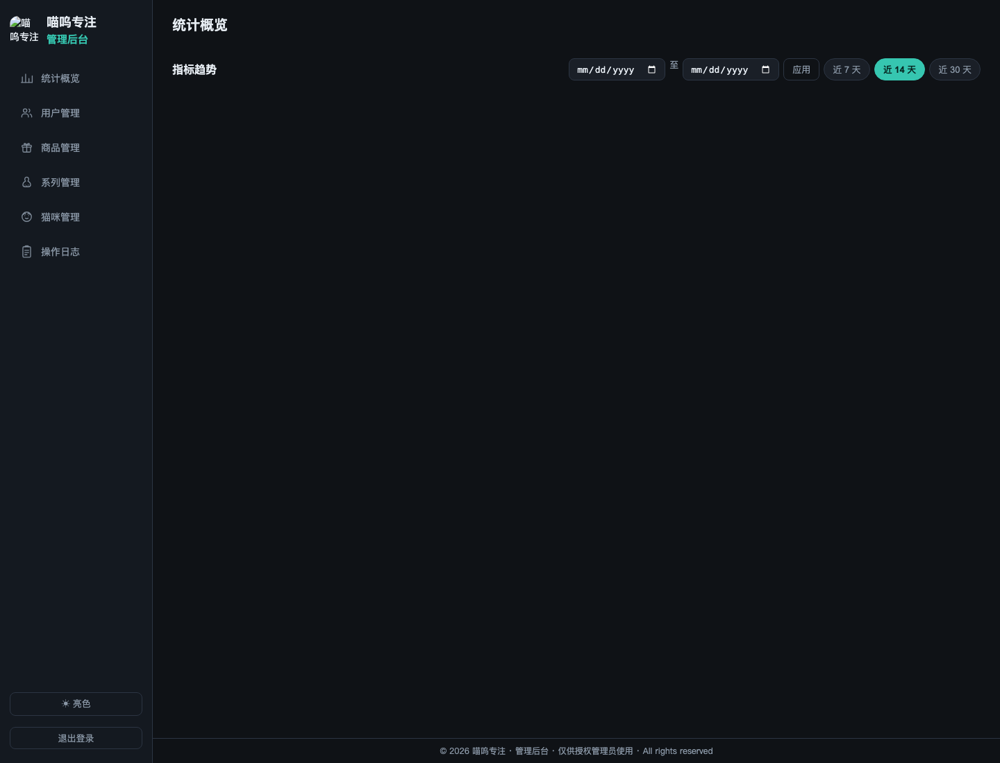
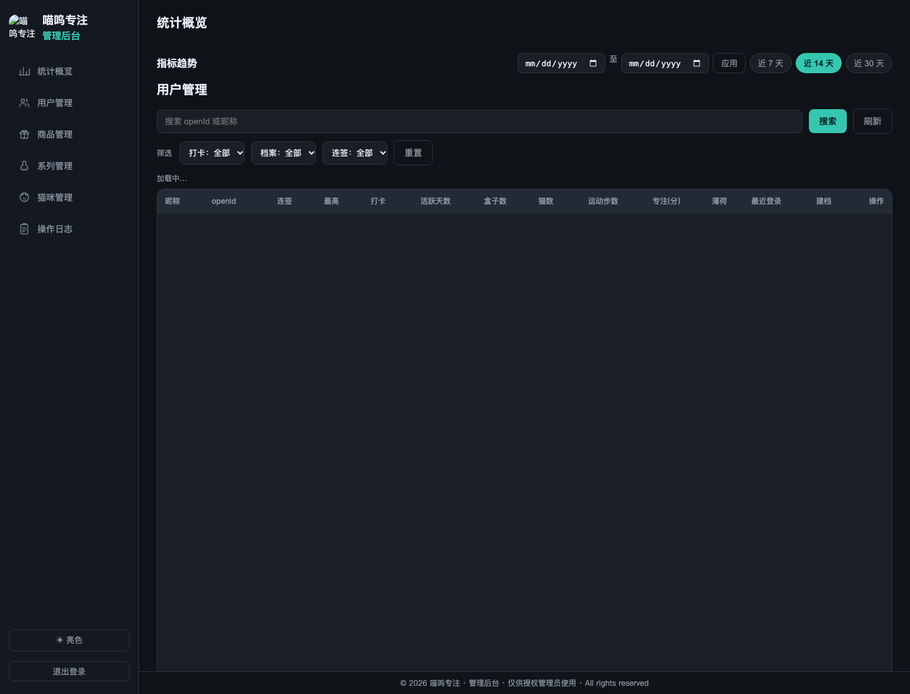
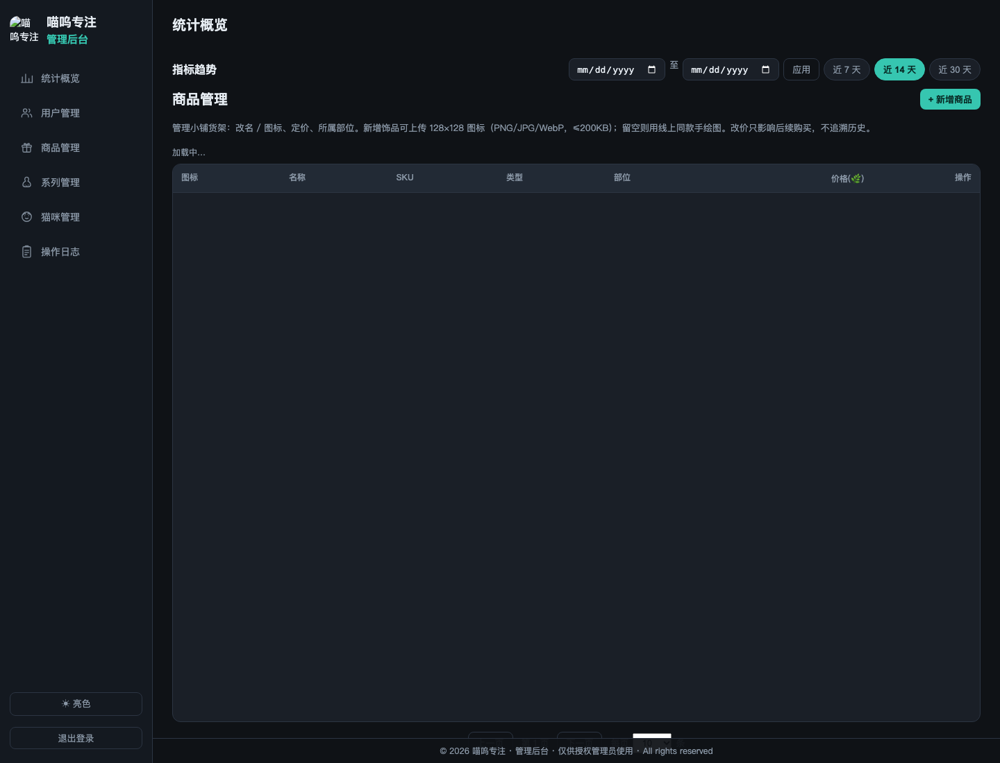
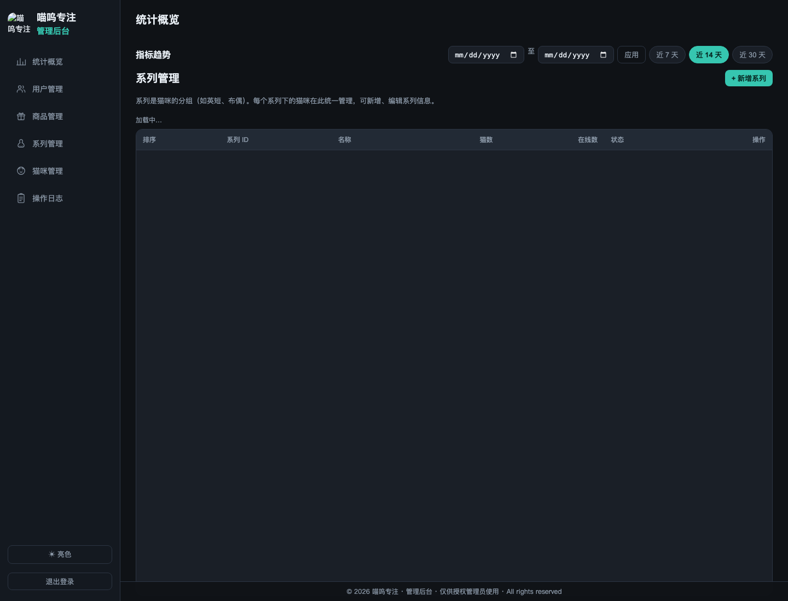
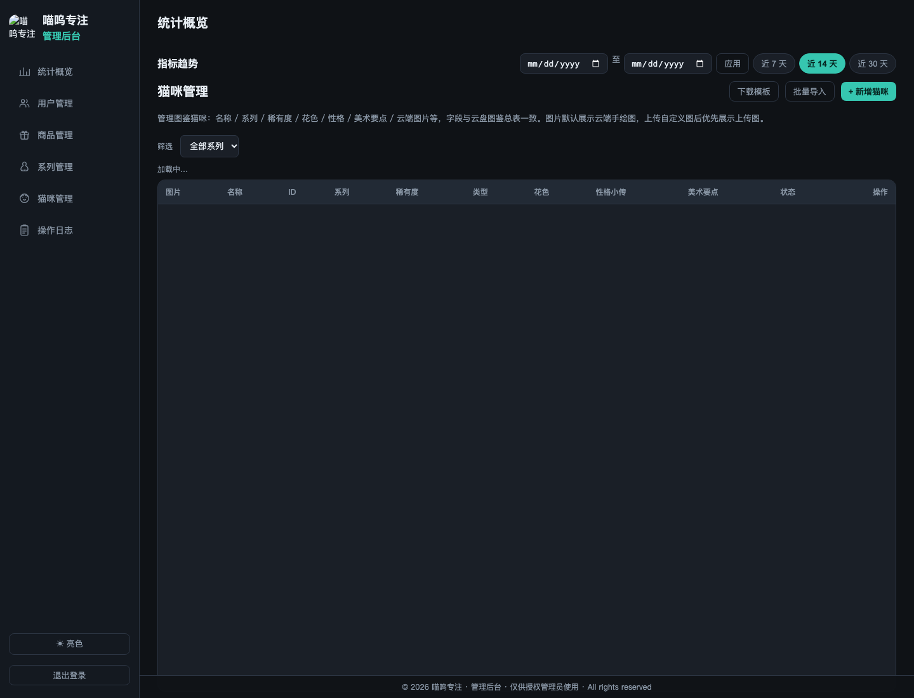
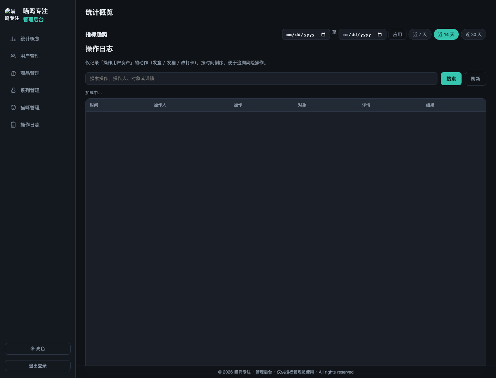

# 后台功能模块

管理后台用于运营「喵呜专注」：查看数据、管理用户与猫咪资产、处理盲盒商品、追溯操作日志。

> 以下截图为后台界面展示，功能需管理员权限登录使用。

## 模块总览

左侧菜单共 6 个模块：

- 统计概览
- 用户管理
- 商品管理
- 系列管理
- 猫咪管理
- 操作日志

## 统计概览

按日期区间（近 7 天 / 14 天 / 30 天）查看指标趋势，含专注、走步、开盒等核心数据。

## 用户管理

搜索 openid 或昵称，查看连签、活跃天数、盒子数量、运动步数、专注分钟、薄荷余额、最近登录时间等；支持排序与分页，可对用户资产做调整并记录操作。

## 商品管理

管理盲盒商品配置。

## 系列管理

管理猫咪系列（7 个大系列）及其排序与展示。

## 猫咪管理

管理 84 只猫的档案、稀有度、立绘与上线状态。

## 操作日志

只记录「操作用户资产」的动作（发盒 / 发猫 / 改打卡），按时间倒序，便于追溯风险操作。

